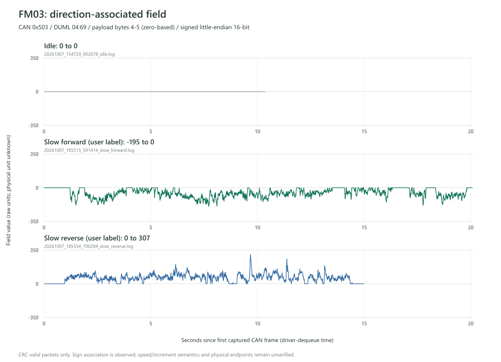

# FM03 协议分析

> 2026-10-08 15:40:15：当前常绿候选replay_gate0_stable_50ms_echo。50ms零值组合完整120秒无panic，2398请求+2398拨轮双CRC/分片完整；用户确认发送期间绿灯常亮、手拧有阻力，自动停发板子变蓝后电机回红。已找到零值工作组合，最小报文必要性及非零运动仍未验证。固件RST后自动发送120秒再监听；先读HANDOFF最新入口和WORK_LOG末尾，下文多数验证属于早期阶段。

## Agent 接手入口

先读 [HANDOFF.md](HANDOFF.md) 获取当前交接快照，再按 [AGENTS.md](AGENTS.md) 维护记录。历史工作见 [WORK_LOG.md](WORK_LOG.md)，每份抓包的动作语义和用途见 [captures/INDEX.md](captures/INDEX.md)。

Git 已初始化在 `main`；本次交接建立本地初始提交，没有远程或推送。当前版本使用 `git log -1 --oneline` 查询；每次完成工作更新交接与日志，检查并记录 Git 状态。原固件备份不在 Git 中。

## 目标

被动监听 RS3 ↔ DJI FM03 的正常控制链路，保留原始抓包，再依据证据分析协议。后续主动控制另立阶段。

## 已知硬件与待确认事项

- 开发板：ESP32-S3-DevKitC-1 N16R8。
- CAN 收发器：SN65HVD230 已确认。2026-10-07 用户说明拆除模块上 120 Ω 的原因：它是并联接到既有 RS3↔FM03 链路上做监听时产生的**第三个终端**，按“不新增第三个终端”的要求拆除，该判断正确（三个 120 Ω 并联约 40 Ω，负载过重）。**终端已实测结清：RS3 与 FM03 两端各带 120 Ω，总线约 60 Ω，是标准双端终端**，因此监听分支不接终端即为正确接法。Rs 接法仍待核实；若日后加第二个收发器，其 120 Ω 同样必须断开。
- 显示屏：0.49 英寸、64 × 32 OLED。接口、控制器、地址及引脚待确认。
- 已在 RS3 ↔ FM03 链路收到经典 CAN 标准数据帧，1 Mbps 实测可正常解码；连接器引出线对应的原始 USB-C 引脚及直流电压尚未记录。

旧聊天[《查找大疆驱动方案》](https://chatgpt.com/c/6abb8489-1ea4-83ee-b3a0-8857f2c41a51)曾依据示波器图推测可能为 CAN，并提出 1 Mbps / 500 kbps 候选。该图尚未重新核验，这些均不是已确认事实。

## 工作阶段

1. **核实硬件与链路。** 确认 ESP32 芯片完整型号、收发器电平/终端/静默能力、连接器线序和电压、总线类型，以及 OLED 接口、控制器、地址和引脚。
2. **建立被动监听。** 仅在确认是 CAN 后，使用外接收发器和 ESP32 TWAI Listen Only 模式。不要将 GPIO 直接接入 CAN，也不要盲目添加终端电阻。先输出串口原始日志，之后再加入 OLED 状态显示。

   候选接线：开发板 3V3 → SN65HVD230 VCC，GND 共地；GPIO4（TWAI TX）→ D/TXD，GPIO5（TWAI RX）← R/RXD；CANH/CANL 只接到线序已核实的总线。Rs 拉高可关闭驱动并保留接收，但必须先核实模块电路；如果 Rs 已接地，不要直接拉高，也不要求为此改板。先核查模块是否带 120 Ω 终端及原总线终端，不新增第三个终端。OLED 仅在确认为四针 3.3 V I²C 模块时，候选接线为 GPIO8 → SDA、GPIO9 → SCL、3V3 → VCC、GND → GND；控制器和 I²C 地址待确认。候选 GPIO 需与实物引脚及其他占用核对。
3. **分场景重复抓包。** 分别记录静止、慢速正转、慢速反转、快速正转、快速反转及校准；每次标记动作时间。原始日志保留时间戳、ID、扩展帧标记、帧类型、DLC、数据字节及丢帧统计。
4. **基于证据分析协议。** 比较 ID、周期、字段和校验。不能仅凭 ID 判断发送方向；需要结合物理连接、动作时序与多次抓包验证。

规划：gpt-6-astra。执行：gpt-6-sol，medium。

## 第一版监听固件

`src/main.cpp` 固定使用 GPIO4 TX / GPIO5 RX、TWAI Listen Only、接收所有 ID，发送队列长度为零，代码不调用 CAN 发送 API。串口经开发板 USB-UART 口输出，921600 baud；OLED 和 PSRAM 暂不启用。板型沿用 DevKitC-1，Flash 容量和分区覆盖为 N16R8 的 16 MB。

PowerShell（项目目录）：

```powershell
.\.venv\Scripts\python.exe -m platformio run -e listen_1m
.\.venv\Scripts\python.exe -m platformio run -e listen_1m -t upload --upload-port COM17
.\.venv\Scripts\python.exe tools\capture.py --port COM17 --seconds 15 --label idle
```

2026-10-07 已通过 esptool 确认 COM17 为 ESP32-S3（revision v0.2），8 MB 内置 PSRAM、16 MB Flash，与 N16R8 对应。需要验证 500 kbps 时，将编译/烧录环境改为 `listen_500k`。速率不会自行切换，日志包含当前 bitrate。

首次烧录前的全量 Flash 备份保存在 `backups/esp32s3_before_listener_20261007.bin`（16 MB），读取过程日志为 `backups/read_flash.log`。备份目录不纳入 Git，保留在本机。

首次建立环境：用本机 Python 创建 `.venv`，随后 `python -m pip install -r requirements.txt`。当前机器已有 PlatformIO 的 Espressif 工具链缓存。

原始串口字节原样保存到 `captures/*.log`，旁边的 JSON 记录时间（北京时间）、端口、帧数、ID 分布、序号缺口、首末状态和固件错误。不同动作分别用 `idle`、`slow_forward`、`slow_reverse` 标签，标记实际动作时间。

帧行格式：`t_us,sequence,id_hex,extended,rtr,dlc,data_hex`。`t_us` 是高优先级接收任务从驱动取帧时的开机后微秒数，**不是硬件帧边沿时间**。远程帧保留 DLC，但 data_hex 为空。序号缺口只反映接收任务之后的丢帧；驱动之前的丢帧另看状态。

每秒 `# STATUS` 包含 `rx`（任务收到的累计帧数）、`logger_dropped`（串口输出队列丢帧）、`rx_missed`（驱动接收队列/勘误相关丢帧）、`rx_overrun`（硬件 FIFO 溢出）、`bus_errors` 和两级队列积压。这些计数从启动起累计；连续抓包应比较首末值。串口字符行吞吐有限，不能保证满负荷 1 Mbps 总线无损；出现丢帧时先保存证据再调整采集方式。烧录、更换速率和复位会产生采集空档。

主机工具自检：`.\.venv\Scripts\python.exe tools\capture.py --self-check`。成功编译只证明软件可构建，真实链路、速率和完整性必须通过抓包验证。

### 模式切换：板上按键 + 内置灯（2026-10-07 23:20 起，尚未硬件验证）

`src/main.cpp` 现在支持两种模式，**上电永远 Listen Only**：

- **长按板上 BOOT 键（GPIO0）2 秒**切换 listen / transmit。
- **内置可寻址 RGB 灯**指示模式：慢蓝脉冲 = 监听；快红脉冲 = 可发（切换后 1.6 秒常亮便于确认）。
- `# STATUS` 增加 `mode=` 与 `mode_switches=` 字段；既有字段和帧行格式未变，上位机与解析脚本无需改动。
- **transmit 模式只是让发送成为可能，固件里没有任何 `twai_transmit` 调用，一个 CAN 帧都不会自发。**

切换模式会停止并重新安装 TWAI 驱动（`twai_stop` → `twai_driver_uninstall` → `twai_driver_install` → `twai_start`），因此切换只发生在主循环里，不与状态打印或帧写入重叠。

灯所在引脚：本项目用的是 Arduino core 2.0.17，其 `esp32s3` 变体 `PIN_NEOPIXEL = 48`。若板子是 v1.1（灯移到 GPIO38）用 `-DLED_RGB_GPIO=38`；`-DLED_RGB_GPIO=-1` 可完全关灯。注意该核心提供的是 `neopixelWrite()`，**没有** core 3.x 的 `rgbLedWrite()`。

```powershell
# 默认（灯在 GPIO48）
.\.venv\Scripts\python.exe -m platformio run -e listen_1m -t upload --upload-port COM17
# v1.1 板（灯在 GPIO38）
.\.venv\Scripts\python.exe -m platformio run -e listen_1m  # 需在 platformio.ini 的 build_flags 加 -DLED_RGB_GPIO=38
```

**接线契约（三条都必需）**：

1. **监听模块的 Rs（SN65HVD230 引脚 8）接 3.3 V**，让它的驱动器在硅层面永久关断——这样即使固件处于 transmit 模式、即使插错了模块，也发不出去。别让这个 Rs 悬空。
2. 收发模块的 Rs 接地或浮空。
3. 同一时刻**只允许一个模块的 CANH/CANL 接到总线**（旁路点加第三个终端会把总线拉到约 40 Ω）。

**尚未验证**：按钮判读、灯的实际颜色与可见性、切换对采集连续性的影响、GPIO0 空闲电平。固件启动时会打印 `# BUTTON idle_level=HIGH expected` 或 `unexpected_check_wiring`，上电即可核对。烧录前请确认当前没有在抓包；首次烧录后先按原流程抓一段确认监听正常，再试长按切换。

## 当前验证结果（2026-10-07）

- `listen_1m` 和 `listen_500k` 均编译成功，抓包脚本自检通过。
- 原 Flash 已完整备份（16777216 字节）；SHA256：`8822C84EFF9E59C5231930BBE3E4FC2F5C010051ADDA6FD6EC723B983941D00F`。
- COM17 已成功烧录 `listen_1m`，烧录数据校验通过；当前串口为 921600 baud，CAN 配置为 1 Mbps Listen Only。
- 尚未连接真实总线。`captures/20261007_151952_378136_no_bus_startup.log` 记录了约 5 秒启动后状态：rx=0、各丢帧/总线错误计数为 0，没有固件错误。这仅验证监听固件和串口采集能运行，**不确认线序、实际 CAN 速率或总线接收能力**。
- 下一步：断电接入已核实的 CANH/CANL/GND 支路，保持 RS3 ↔ FM03 原链路，开机确认原拨轮控制正常，再抓静止、慢速正转和慢速反转数据。没有总线数据时暂不尝试 500 kbps。

## 可视化上位机

双击项目根目录的 **`启动上位机.cmd`**，浏览器会打开 <http://127.0.0.1:8765>。服务只监听本机地址，使用现有 Python 环境和 pyserial，无额外界面依赖。服务已运行时，重复启动会打开现有界面。

1. 选择串口（当前为 COM17，USB 串口优先显示），选本次场景。
2. 点击 **开始抓包**：连接串口，实时显示接收帧数、最近一秒帧率、时间、ID 分布、最新 150 帧、固件状态和错误计数。
3. 点击 **停止并保存**：停止电脑端记录，关闭并释放串口，生成 `.log` 原始日志和 `.json` 摘要。点击界面上的下载按钮可获取本次文件；原件始终保存在项目 `captures/` 中。

4. 点击 **关闭上位机**：如正在抓包，先停止并保存原始日志及摘要、释放串口，再退出本机服务。页面显示“上位机已关闭”，不再轮询；日志保留在 `captures/`。串口尚未停止或摘要未保存时会显示错误并保留服务，可以稍后重试。再次使用时双击 `启动上位机.cmd`。

仅关闭网页不会停止正在运行的采集。ESP32 固件继续被动监听，电脑端按钮不发送 CAN 控制帧，也不关闭电脑或RS3/FM03硬件。CAN 速率由已烧录的固件决定，界面显示的是固件配置值，不能据此认定实际总线速率。

显示用列表有 150 帧上限，完整原始串口字节仍写入文件。固件丢帧/总线错误显示本次首条状态之后的增量，详情显示开机后累计值；序号缺口单独计数，避免重复相加。固件重启后计数增量继续累计。端口被其他工具占用或设备断开时显示错误，已经接收的日志保留。

**04:69 实时观察：** 开始抓包后，两路候选字段面板显示 `0x503/0x201` 的有符号原始值、最近曲线及非零→零的时刻。可勾选“归零时提示音”；只在0x503新归零且数据仍新鲜时响一次，初始零值不会响。快速拨一下后松手，观察出现“已归零”时电机是否仍在转，不必录像或精确记秒。提示受串口及网页刷新延迟影响，适合判断明显的运动延续，字段含义/单位尚未确认。

实时字段仅接受报头及整包CRC通过、地址/命令/前缀匹配的数据；两路分别重组，序号缺口、重启、丢帧计数变化处清空并重新计时。超过0.5秒没有该字段有效包，数值显示“— / 数据超时”，停止后只显示末次快照，不视为实时归零。曲线每路最多保留1000包，并展示最近约10秒；JSON摘要保留这部分候选状态，完整证据始终是原始 `.log`。

手动启动与测试：

```powershell
.\.venv\Scripts\python.exe tools\gui_server.py --open
.\.venv\Scripts\python.exe -m unittest discover -s tools -p test_gui.py -v
```

上位机测试覆盖分片串口数据、开始/停止及重新抓包、串口异常后保存、计数重置、输入校验和 HTTP 控制/下载。真实 COM17 的开始/停止验证已通过，收到 1 Mbps 固件状态，尚未接总线，因此仍为 0 帧。运行错误日志保存在 `.pio/gui-server.log`。

## 首次总线抓包成功（2026-10-07 15:44，北京时间）

原始记录：`captures/20261007_154446_862533_capture.log`。用户确认本次约 30 秒期间曾向一个方向转动拨轮一次，具体方向及动作时间未标记，不能按文件名 `capture` 将整段当作静止基线。

- 已解析 52666 个有效 CAN 标准数据帧，DLC 为 2–8。记录时长 30.44 秒，有效帧时间跨度约 30.42 秒。
- ID / 帧数：0x106 / 12294；0x201 / 12434；0x232 / 6688；0x503 / 9090；0x504 / 12160。
- 帧序号连续、无重置。收到的固件状态中 logger_dropped、rx_missed、rx_overrun 和 bus_errors 全部为 0；这不等同于证明采集边界无损。文件开头有少量非帧字节，结尾有 22 字节未完成行，均保留在原始记录中。
- 将各 CAN ID 的 data 字节分别按顺序拼接，按 DJI DUML 0x55 包格式检查报头 CRC8 和整包 CRC16，重组出 14633 个双校验通过的包。CRC8：初值 0x77、反射多项式 0x8C；CRC16：初值 0x3692、反射多项式 0x8408。参考来源：[dji-firmware-tools 原始实现](https://github.com/o-gs/dji-firmware-tools/blob/master/comm_dat2pcap.py)。使用一个实际完整 19 字节包验证了两种校验计算，再扫描全量数据。
- 初步命令组：0x503 包含 04:69；0x201 包含 04:69、04:2F；0x106 包含 04:05、04:10；其他 ID 包含 04:2F、24:20、00:0E。两个 ID 上的 04:69 均出现 428 种 payload，值得在静止/方向对照中优先比较，**目前未确定控制意义或物理发送方向**。

包长度、命令组计数及完整包样例保存在 `captures/20261007_154446_862533_capture.protocol.json`。此次重组使用原始文件，有效帧序号连续；后续出现丢帧/重启时必须在断点处重新建立重组边界。

下一组对照：在上位机依次选择静止、慢速正转、慢速反转，分别保存独立记录。静止录 10 秒；两个方向各录 10 秒，前 2 秒静止、中间约 3 秒缓慢转动、最后约 5 秒静止。保持接线、速率和其他操作一致，再比较重组后的应用 payload。

## 静止基线与首次转动对照（2026-10-07 15:47，北京时间）

用户确认 `captures/20261007_154729_002678_idle.log` 为静止记录。时长 10.41 秒，17987 帧、5 个 CAN ID，帧序号连续、无重置；重组出 4998 个 CRC8/CRC16 均通过的包。

本段首末固件状态均为 logger_dropped=273、bus_errors=1、rx_missed=0、rx_overrun=0，**本段已记录状态中均无新增**。273 次输出队列丢帧和 1 次总线错误在首条状态时已经存在，不能算作本段新增，也不能把累计计数描述成零。日志结尾 37 字节未完成行已保留。

重点候选：

- CAN 0x503，逻辑地址 E5→BF，命令 04:69，6 字节应用 payload；静止期间共 1037 包，内容始终为 `0F 04 08 19 00 00`，报文取帧间隔中位数约 10.002 ms。
- CAN 0x201 上 E5→52 的同一命令、同长度 payload 也有相同规律。
- 首次含拨轮转动的记录中，两路 payload 均出现 428 种内容，仅 payload 第 5、6 字节（零起始偏移 4、5）变化，前四字节始终为 `0F 04 08 19`。这是一处明确的拨轮相关候选，尚未证明它直接控制电机。
- 如暂按有符号小端 16 位解读这两个字节，首次记录取值范围为 -557～388，记录开头/末尾为 0。由于动作时间、方向没有精确标记，不能据此认定符号对应某个物理方向，也未确认它是增量、速度或其他编码。
- CAN 0x106 的 04:05 报文在静止时也持续变化，不能把任何变化都解释为拨轮或电机控制字段。

离线分析工具：`tools/analyze_protocol.py`。它按 CAN ID、帧格式和可靠性断点分别重组，校验报头/整包，输出命令组、可变字节偏移及对照 JSON，不连接串口。CRC、受损包、分片重组及丢帧断点自检已通过。

```powershell
.\.venv\Scripts\python.exe tools\analyze_protocol.py --self-check
.\.venv\Scripts\python.exe tools\analyze_protocol.py captures\20261007_154729_002678_idle.log captures\20261007_154446_862533_capture.log
```

结果保存为各原始日志旁的 `.analysis.json`，以及转动记录的 `.vs-idle.json`。接下来仍需慢速正转、慢速反转独立记录，按此前 2 秒静止 / 3 秒转动 / 5 秒静止的节奏，验证最后两字节与物理方向和动作时序的关系。

## 正反转符号验证（2026-10-07）

用户确认已完成慢速正转和反转：`20261007_185515_591414_slow_forward.log`（20.11秒、34777帧）和 `20261007_185554_700204_slow_reverse.log`（15.03秒、25968帧）。序号连续，两段记录状态均无新增丢帧/总线错误；已有累计bus_errors=16首末不变。

命令04:69的payload保持 `0F 04 08 19 LL HH`。末两字节按有符号小端16位读取，静止始终0；用户标记的正转为-195～0（1487负/514零/无正），反转为0～307（1234正/260零/无负），各段首末归零。0x503和0x201对应命令的payload序列在三段记录中逐项一致。

**已验证方向关联，未确认速度/增量、量纲或物理设备映射。** 样本没有独立动作时间标记，不能把字段非零时间当作已测量的运动时间，也不能换算电机转速或角度。下一步：同方向较快拨轮对照，检查幅度是否随速度变化。

复现工具为 `tools/analyze_direction.py`；对照图和JSON/逐包CSV在 `reports/20261007_direction_validation.*`。



## 快慢幅度与电机滞后观察（2026-10-07 19:46）

快速正转记录15.30秒、26395帧，快速反转18.72秒、32327帧；各段帧序号连续、记录的丢帧/错误计数没有新增。已有累计logger_dropped=50、bus_errors=48首末不变。

04:69候选值的非零绝对值中位数：慢正67、快正467.5；慢反70、快反602。快拨幅度较大，约6.98/8.6倍，但这是字段幅度倍率，**不是电机转速倍率**。快速段有少量反号，正转236负/4正，反转213正/14负，不能说全部只取同一符号。观测峰值达到-2048/+2048，尚不能证明协议上限。

用户观察电机转速有上限，拨轮过快时不会继续提高电机速度，而且拨轮停后电机会继续转一会儿。数据与观察支持“拨轮输入速率/增量”候选；电机可能在限速追赶累积目标或执行缓停，尚未证明机制。不能将末两字节直接当作电机实际速度。

下一步只需一次明确的快速拨动后完全停手，继续抓到电机停止，并记录/视频标出拨轮停和电机停的时间，以比较输入归零与真实电机运动的关系。当前仍被动监听，不发送CAN控制帧。

本轮离线工具 `tools/compare_speed.py` 输出 `reports/20261007_speed_comparison.json/.csv`。原始抓包不修改；所有记录、例外和未确定事项已写入HANDOFF。

## 离线报文构造与双CRC回验（2026-10-07 22:50）

`tools/build_packet.py` 构造 DUML 包并按实包重算报头 CRC8 与整包 CRC16。它**只做内存计算**：不 import pyserial、不打开串口、没有任何 CAN 发送路径，因此可以在保持只监听链路不变的前提下，验证未来主动阶段要用的编码器。

```powershell
# 自检
.\.venv\Scripts\python.exe tools\build_packet.py --self-check
# 构造一个包（打印实包十六进制、双CRC、字段与CAN分片），只是打印，不发送
.\.venv\Scripts\python.exe tools\build_packet.py --build source=0xE5 destination=0xBF sequence=0x1234 command=04:69 payload=0F0408190000
# 逐包复核已有抓包
.\.venv\Scripts\python.exe tools\build_packet.py captures\20261007_154729_002678_idle.log --show 5
```

11 份日志共 **76110 个 CRC 有效包全部逐字节重建成功，0 处不一致**，且与各 `.analysis.json` 的 `crc_valid_packets` 合计完全相等；脚本内含覆盖度守卫，包数不符即报错。报告保存在 `reports/20261007_packet_build_validation.json`。

报头字段更正：偏移 2 是**高 6 位版本 + 低 2 位长度高位**，实包里的 `0x04` 是移位后的字节（版本值 = 1），不是“低 4 位版本”。

**编码正确不等于报文可以安全发送或必需。** 物理端点、使能条件和发送范围仍未确认，当前阶段依然只监听、不发 CAN 帧。

## 跨记录稳定性复核（2026-10-07 23:05）

`tools/check_stability.py` 按“逻辑地址 / flags / 命令 / 长度”把记录分成若干路由，跨多份抓包做**留一法**复核：某个字节只有在**每一份**带该路由的记录里都取同一个值，才被算作稳定；否则列出各记录的实际取值。采集是否可用由摘要判定（记录区间出现新增丢帧/错误或序号缺口即排除），不靠文件名。

```powershell
.\.venv\Scripts\python.exe tools\check_stability.py --self-check
.\.venv\Scripts\python.exe tools\check_stability.py captures\20261007_154729_002678_idle.log captures\20261007_185515_591414_slow_forward.log --markdown reports\20261007_stability_findings.md
```

9 份健康记录共 **75844 包、27 条路由**，与 `protocol_catalog.json` 总数相等。结论：

- `E5>BF` 的 04:69：payload 偏移 0..3（`0F 04 08 19`）在全部记录稳定，**只有偏移 4、5 变化**（即候选拨轮量）。
- `E5>52` 的 04:69：仅偏移 0、1（`0F 04`）稳定，偏移 2/3 是 DUML 序号，4/5 是候选量。
- **27 条路由的留一法分歧全部为 0**，没有只靠单份记录成立的“稳定字节”。
- 序号步进是**逐路由**规则且记录内自洽（04:10 恒 +5、00:0E 恒 +18、04:05 为 +20、04:69 以 +2 为主偶发 +4），但**不是全局规则**；不得据 +4 断言丢帧。

限制：稳定性只是重复性证据，不等于协议常量；单设备单会话下，稳定字节仍可能是会话常量。报告见 `reports/20261007_stability_validation.json` 与 `reports/20261007_stability_findings.md`。
